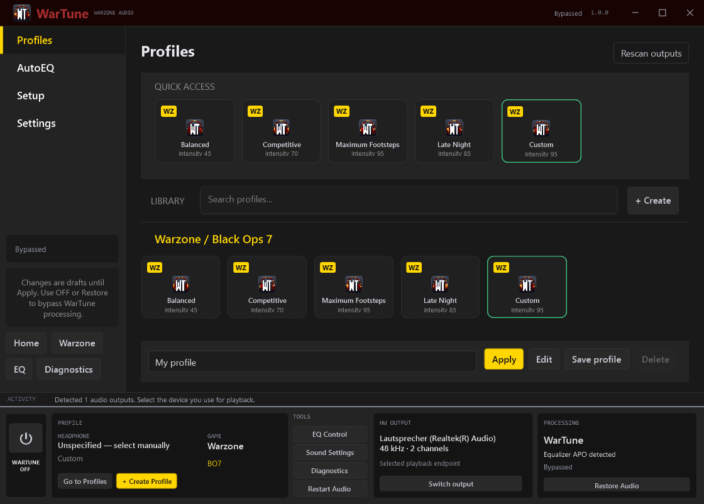

# WarTune

WarTune is a Windows desktop audio utility for Warzone and Black Ops 7. It manages local headphone EQ and listening presets through Equalizer APO, with a native stereo dynamics plug-in.

**[Download WarTune 1.0 for Windows x64](https://github.com/pxnami/WarTune/releases/tag/v1.0.0)**



## Getting started

1. Download and extract the Windows ZIP from Releases. The .NET Desktop Runtime is included.
2. Launch `WarTune.exe`. For a Start menu shortcut and an uninstall entry, run `Install.ps1` from the extracted folder.
3. Open **Setup**, scan your PC, select the playback device and enter your headphone model.
4. Install [Equalizer APO](https://sourceforge.net/projects/equalizerapo/) separately. Attach it to that playback device in its Device Selector and restart Windows if requested.
5. Use stereo output at 44.1–96 kHz. If APO configuration access is denied, use **Run as administrator** in Setup.
6. Choose a preset, apply it, and run a listening test at low volume. Set the game to use the same output.

WarTune processes the selected playback endpoint, including other apps using that endpoint. It does not currently isolate one application's audio.

## Features

- Footstep, gunshot reduction, explosion reduction and intensity controls.
- Built-in presets and locally saved profiles.
- AutoEQ/APO PEQ import, saved headphone profiles and editable parametric filters.
- Frequency-response preview and Windows output level meter.
- A seven-step setup flow, device detection and local diagnostic reports.
- Tray controls, optional Windows startup, per-monitor DPI support and a resizable interface.

The controls adjust EQ and dynamics; they do not identify or separate game sounds. The graph previews filter response, not a measured spectrum. APO being installed does not prove it is attached or processing: WarTune reports processing only when the native plug-in's heartbeat is observed.

## Audio configuration and removal

WarTune adds a marked include to APO's configuration and keeps a backup. **OFF** bypasses its own processing. **Restore** removes its include while preserving unrelated APO edits. Closing or exiting the desktop app does not turn off processing hosted by Windows Audio.

The installer does not install audio drivers. Use Windows Installed Apps to uninstall WarTune after exiting the tray utility. Personal profiles are retained. There is no account, telemetry or diagnostic upload.

Existing users retain the `ArtIsWarAudio` settings folder, managed APO identifiers and DSP filename for compatibility. These internal names are intentional.

## Build and test

Requires Windows x64, the .NET 8 SDK and Zig 0.14.1 on PATH:

```powershell
powershell -NoProfile -ExecutionPolicy Bypass -File scripts/build.ps1 -Test
```

The script builds the native plug-in, runs the managed and native tests, and publishes a standalone app into `release/`. Build outputs and local settings are excluded from Git.

The release was checked locally with the regression tests and all eight UI pages at normal and minimum window sizes on Windows at 125% scaling. Hardware-specific APO attachment and an actual listening test still need verification on each PC.

## License

The source is available under the [MIT license](LICENSE).
